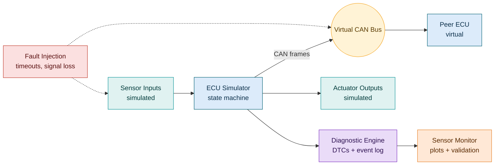
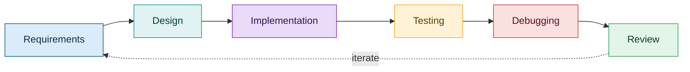

<div align="center">

# 🚗 Automotive Embedded Projects

**Simulation-based projects in ECU control, vehicle communication, diagnostics and fault handling**


[Overview](#-overview) · [Projects](#-projects) · [Architecture](#-planned-architecture) · [Roadmap](#-roadmap) · [Getting Started](#-getting-started) · [Contact](#-contact)

</div>

---

## 🎯 Overview

Modern vehicles are networks of electronic control units (ECUs) exchanging signals over in-vehicle buses. This repository explores the software side of that world through simulation projects that run on a development machine, with the aim of porting selected parts to microcontroller targets later.

| | |
|---|---|
| 🎓 **Goal** | Build practical skills in ECU logic, CAN communication, diagnostics and fault handling |
| 🧪 **Method** | Requirements, design, implementation and automated tests for every project |
| 📦 **Format** | Self-contained projects, each with its own README, build steps and test results |
| ⚠️ **Scope** | Learning simulations. Not production software and not safety-certified |

---

## 👤 Author

**Vishnuprakash Jagan Mohan** · M.Sc. Embedded Systems, TU Chemnitz, Germany

Over four years of industrial R&D experience in embedded hardware, firmware and microcontroller-based control systems, including PCB design, Embedded C, CAN / RS485 / Modbus RTU communication and hardware-software integration. This repository extends that background into automotive embedded software.

---

## 🛠️ Projects

| # | Project | Focus | Topics | Status |
|:-:|---------|-------|--------|:------:|
| 1 | 🔵 [ECU Simulator](#-1-automotive-ecu-simulator) | Control logic | Sensor inputs, state machines, actuator outputs |  |
| 2 | 🟢 [Communication Simulator](#-2-automotive-communication-simulator) | Networking | CAN frames, message handling between virtual ECUs |  |
| 3 | 🟣 [Diagnostic Engine](#-3-ecu-diagnostic-engine) | Diagnostics | Fault identification, trouble codes, event logging |  |
| 4 | 🟠 [Sensor Monitor](#-4-vehicle-sensor-monitor) | Signal handling | Thresholds, plausibility checks, visualization |  |
| 5 | 🔴 [Fault Detection System](#-5-ecu-fault-detection-system) | Robustness | Fault injection, timeouts, safe states |  |

> Status values: **Planned**, **In Progress**, **Complete**. The table is updated as work is committed.

### 🔵 1. Automotive ECU Simulator
A software ECU model that reads simulated sensor inputs, tracks operating states and drives simulated actuator outputs.
- **Objectives:** explicit state machine for operating modes; separate input, logic and output modules; deterministic, testable behavior
- **Deliverables:** source code, state diagram, requirements list, unit tests, usage docs
- **Tech:** `Embedded-style C` `State machines` `Automated tests`

### 🟢 2. Automotive Communication Simulator
A simulation of message exchange between virtual ECUs using CAN concepts.
- **Objectives:** message and signal definitions; frame packing and unpacking; handling of malformed or missing messages
- **Deliverables:** message definition file, communication module, test cases, example bus-traffic logs
- **Tech:** `C / C++` `CAN concepts` `Message processing`

### 🟣 3. ECU Diagnostic Engine
A diagnostic simulation covering how an ECU detects, records and reports abnormal conditions.
- **Objectives:** defined fault conditions; diagnostic trouble codes with status; inspectable event log
- **Deliverables:** fault catalog, diagnostic module, test scenarios, example logs
- **Tech:** `C` `Diagnostics` `Fault handling`

### 🟠 4. Vehicle Sensor Monitor
A monitor for virtual vehicle signals with validation and visualization.
- **Objectives:** threshold detection; range and plausibility checks; signal plots over time
- **Deliverables:** monitoring module, validation rules, plotting scripts, sample datasets
- **Tech:** `C / C++` `Python` `Signal processing basics`

### 🔴 5. ECU Fault Detection System
A fault-handling study built around fault injection and defined safe behavior.
- **Objectives:** inject signal loss and communication timeouts; measure detection time and reaction; define and test a safe state
- **Deliverables:** fault injection harness, fault-reaction logic, test report
- **Tech:** `Embedded-style C` `Fault detection` `Structured testing`

---

## 🧭 Planned Architecture

How the projects are intended to fit together (planned design, not yet implemented):



### Development workflow



**Working principles**

- ✅ **Requirements first:** every project starts with a short list of testable requirements
- 🧩 **Separation of concerns:** input handling, logic and output handling live in separate modules
- 🧪 **Test as you build:** normal behavior and edge cases (invalid inputs, timeouts, boundaries) are automated
- 🔗 **Traceability:** tests reference the requirements they verify
- 📏 **Coding standards:** MISRA C is the reference target where practical; compliance is not claimed unless checked with tooling and documented
- 📝 **Documentation:** assumptions, limitations and results are recorded per project

---

## 🧰 Technology Stack

| Area | Tools and Concepts |
|------|--------------------|
| 💻 Languages | C, C++, Python |
| 🔨 Build | GCC, CMake |
| 🌿 Version control | Git, GitHub |
| 🚘 Domain concepts | ECU architecture, CAN, state machines, diagnostics, fault handling, real-time fundamentals |
| 🔧 Background tools | Altium Designer, STM32 tooling, B&R Automation Studio, MATLAB, LabVIEW |

Each project lists its exact tools and versions in its own README.

---

## 📁 Repository Structure

Target layout once projects are added:

```text
Automotive-Embedded-Projects/
├── README.md
├── LICENSE
├── docs/                       # shared notes and design references
├── 01-ecu-simulator/
│   ├── README.md               # overview, build and test instructions
│   ├── src/
│   ├── include/
│   ├── tests/
│   ├── docs/                   # requirements, diagrams, test results
│   └── CMakeLists.txt
├── 02-communication-simulator/
├── 03-diagnostic-engine/
├── 04-sensor-monitor/
└── 05-fault-detection/
```

---

## 🗺️ Roadmap

| Phase | Objective | Status |
|:-----:|-----------|:------:|
| 1 | Strengthen Embedded C and C++ fundamentals |  |
| 2 | Develop the automotive ECU simulator |  |
| 3 | Add CAN-based communication between virtual ECUs |  |
| 4 | Implement diagnostics and fault handling |  |
| 5 | Build automated testing workflows (unit tests, CI) |  |
| 6 | Study AUTOSAR concepts and software architecture |  |
| 7 | Extend to advanced projects, including microcontroller targets |  |

---

## 🚀 Getting Started

Project code is added incrementally. The steps below describe the intended workflow and will be confirmed per project as each one is published.

**Prerequisites:** Git · GCC or compatible C/C++ compiler · CMake 3.15+ · Python 3.9+ (where visualization scripts are used)

```bash
# Clone
git clone https://github.com/Vishnuprakash-JaganMohan/Automotive-Embedded-Projects.git
cd Automotive-Embedded-Projects

# Build and test a project (template; see each project's README)
cd 01-ecu-simulator
cmake -S . -B build
cmake --build build
ctest --test-dir build
```

---

## 🤝 Contributing and Feedback

This is a personal learning repository, but technical feedback is welcome. Please open an issue with the project and file concerned, what you observed, and what you would suggest instead. For pull requests, please open an issue first to discuss the change.

---

## 📄 License

Released under the MIT License. See [LICENSE](LICENSE) for details.

---

## 📬 Contact

<div align="center">

**Vishnuprakash Jagan Mohan** · Chemnitz, Germany

[](https://github.com/Vishnuprakash-JaganMohan)
[](https://www.linkedin.com/in/YOUR-PROFILE)
[](mailto:YOUR-EMAIL)

</div>
